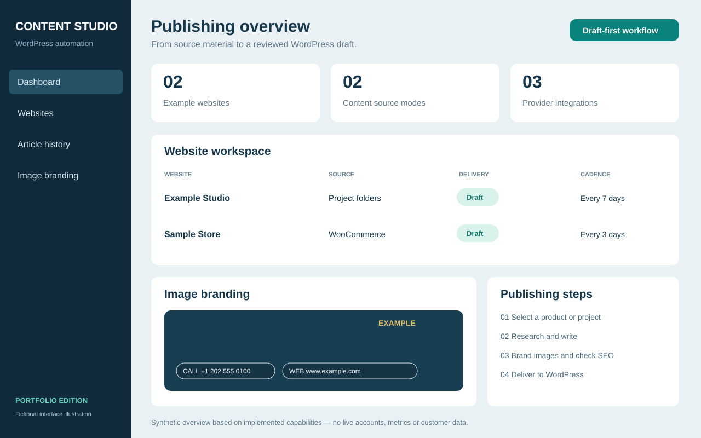
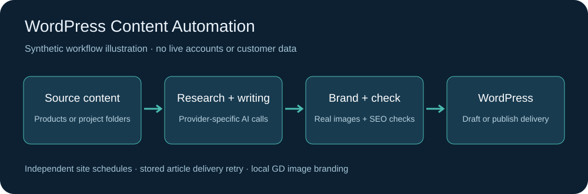
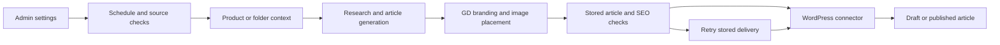

# WordPress Content Automation

### Research-led articles, branded images and a practical multi-site publishing workflow.

A PHP application for turning product information or project folders into researched articles, branded images and WordPress drafts across multiple websites.

**Portfolio edition:** anonymized application source with example configuration. Production accounts, customer content, uploads, logs, recovery tools and release history are excluded. The connector namespace is renamed consistently for this edition; install the included connector on a disposable WordPress site. This is not a hosted demo or a claim of independently verified production performance.



*Original interface illustration using fictional data; not a live admin screenshot.*

## Problem and scope

Publishing teams need to coordinate source selection, research, image preparation, SEO metadata and delivery without maintaining a separate manual workflow for every website. This implementation brings those steps into a multi-site admin application. The case study includes folder-based content, WooCommerce product selection, provider integration, independent schedules, local image branding, and a correction that distributes article images between complete text blocks.

## Capabilities

- Configure each site's source, provider, schedule and WordPress draft/publish mode independently.
- Select WooCommerce products through the connector or process folders containing `title.txt`, `description.txt` and real images.
- Request research-led articles through OpenAI, Anthropic or Qwen integrations. Research balance and writing rules are instructions, not independently measured guarantees; provider behavior and model availability require verification in the intended environment.
- Store articles and retry WordPress delivery without regenerating their text. Due-date checks and a one-attempt-per-site-per-day automatic guard limit unintended generation.
- Apply logos and horizontal rounded text pills with GD. Text/border and background opacity are independent; bundled fonts support selected standalone Unicode icons. Supersampling smooths pill borders.
- Spread body images across complete text blocks instead of inserting a consecutive image group. Short articles may use fewer body images.
- Deliver category, featured media and Yoast metadata, and record heuristic SEO checks. Scores do not guarantee rankings or Yoast results.
- Keep WordPress application passwords and provider keys encrypted using Sodium. Admin sessions and forms use authentication and CSRF checks.

## Workflow





## Source map

| Component | Source |
| --- | --- |
| Admin settings and dashboard | [public/index.php](public/index.php) |
| Scheduling, article orchestration and image spacing | [BlogAutomationService.php](app/Services/BlogAutomationService.php) |
| Provider requests and prompts | [BlogAIService.php](app/Services/BlogAIService.php) |
| WordPress/media client | [WordPressBlogService.php](app/Services/WordPressBlogService.php) |
| Local image rendering | [BlogImageBrandingService.php](app/Services/BlogImageBrandingService.php) |
| Unicode font mapping | [BrandingText.php](app/Services/BrandingText.php) |
| WordPress connector | [portfolio-blog-connector.php](wordpress-plugin/portfolio-blog-blog-connector/portfolio-blog-blog-connector.php) |
| Initial database schema | [001_initial.sql](database/migrations/001_initial.sql) |

## Setup in an isolated environment

Requires PHP 8.2+ with PDO MySQL, cURL, Sodium, mbstring, GD with working FreeType, and MySQL/MariaDB. EXIF support is useful for camera orientation. Apache must honor the supplied `.htaccess` rules. There is no Composer dependency tree.

1. Copy `.env.example` to `.env`. Fill in a dedicated empty database and a new database user. Generate independent keys, for example `php -r 'echo bin2hex(random_bytes(32)), PHP_EOL;'` twice for `APP_KEY` and `SETUP_KEY`. Do not reuse example or production credentials.
2. Import `database/migrations/001_initial.sql` into that empty database only. The connection runs idempotent field upgrades. Do not blindly re-run the reference `002_branding_pills.sql` after the automatic upgrade.
3. Create writable `storage/logs`, `storage/branding` and `page-content` directories. Configure HTTPS with the project root as the Apache document root. Keep private directories protected by `.htaccess`; do not expose the project with an unprotected static server.
4. Open root `setup.php`, supply your setup key and create an administrator. Delete both `setup.php` and `public/setup.php` afterward.
5. Install `wordpress-plugin/portfolio-blog-blog-connector` on a disposable WordPress site. Use a dedicated WordPress user and Application Password with permissions for the selected operations. Yoast is needed for its metadata features; WooCommerce is needed only for product mode.
6. Add a website in the admin with Draft delivery and scheduled automation disabled while evaluating. Configure a supported model and your own provider credentials only when ready to incur API costs.
7. For folder mode, add your own authorized images under `page-content/example-project/001-topic/` alongside `title.txt` and `description.txt`.
8. Once intentionally enabled, a cron such as `*/15 * * * * /usr/bin/php /srv/content-automation/cron/blog.php` checks due sites. Adapt the PHP binary and directory to your environment.

**Evaluation boundaries:** there is no global dry-run switch. Connection checks make network calls. Manual generation can incur AI charges and upload media even in Draft mode. Publish mode can create public posts. Do not use real client accounts for a casual demonstration.

## Validation

Run against this edition, without production configuration:

```sh
find app config cron public tests wordpress-plugin -name '*.php' -exec php -l {} \;
php -l index.php
php -l setup.php
php tests/image-spacing.php
php tests/branding-pills.php
```

The spacing tests cover short/long bodies, unique insertion boundaries, text preservation and list/table safety. The branding suite requires native GD/FreeType and checks Unicode mapping, horizontal layout, positions and independent opacity. The tests do not call WordPress or an AI provider. Branding tests write a synthetic image to the system temporary directory.

Local PHP 8.2 checks passed for all 23 PHP files, the image-spacing regression suite and Unicode font coverage validation. Native GD/FreeType rendering has not been re-run against this sanitized edition. Live WordPress, MySQL, provider delivery and scheduling have not been end-to-end verified for this sanitized edition.

## Portfolio relevance and licensing

Relevant work includes PHP backend development, WordPress REST integration, WooCommerce content workflows, AI-assisted publishing, scheduled jobs, image processing and regression debugging. No business impact metrics or sole-authorship claim is implied.

No additional source-code reuse license is granted by this portfolio edition. Bundled fonts retain their [OFL license](public/assets/branding-fonts/OFL.txt) and [modified-font notice](public/assets/branding-fonts/GD-FONTS-NOTICE.txt). Rebuilding font companions is optional and requires Python FontTools; production rendering uses the bundled generated fonts.
